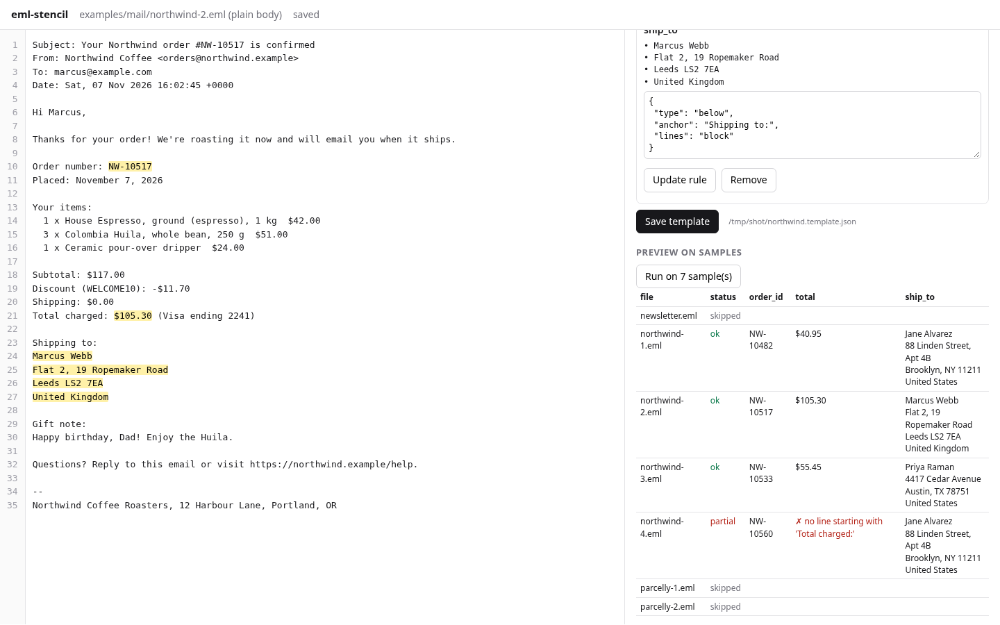

# eml-stencil

Highlight the values you want in **one** example email, get a small JSON template, and parse every other email of that family (order confirmations, shipping notices, invoices, booking emails from the same sender) into JSON or CSV. It runs locally, uses no AI, and has no dependencies beyond the Python standard library.

It's a local take on the template-based parsing that hosted email parsers such as Parsio offer. The template is plain JSON with readable rules, so you can check it into git, edit it by hand, and run it in a script, a cron job or an n8n HTTP step.



```
pip install git+https://github.com/jatingargiitk/eml-stencil
eml-stencil ui examples/mail/northwind-2.eml      # opens http://127.0.0.1:<port>/
```

In the page, select a value in the email, type a field name and click **Add field from selection**. The rule appears next to the value it extracts. **Run on N sample(s)** applies the template to every `.eml` in the same folder (or `--samples DIR`), and **Save template** writes `northwind-2.template.json` (or `--template PATH`). Everything below uses the CLI, which does the same thing without a browser. Every output shown is real and is re-checked in CI (see [Tests](#tests)).

Python 3.9+. The sample emails in `examples/mail/` are made up: fictional shops on `example` domains.

## 1. Look at the text rules run on

Rules run on one plain-text view of the email: Subject/From/To/Date, then the body. The body is the `text/plain` part, or the `text/html` part turned into text when there's no plain part. `show` prints that view with line numbers.

```
$ eml-stencil show examples/mail/northwind-2.eml
# examples/mail/northwind-2.eml (plain body)
 1  Subject: Your Northwind order #NW-10517 is confirmed
 2  From: Northwind Coffee <orders@northwind.example>
 3  To: marcus@example.com
 4  Date: Sat, 07 Nov 2026 16:02:45 +0000
 5
 6  Hi Marcus,
 7
 8  Thanks for your order! We're roasting it now and will email you when it ships.
 9
10  Order number: NW-10517
11  Placed: November 7, 2026
12
13  Your items:
14    1 x House Espresso, ground (espresso), 1 kg  $42.00
15    3 x Colombia Huila, whole bean, 250 g  $51.00
16    1 x Ceramic pour-over dripper  $24.00
17
18  Subtotal: $117.00
19  Discount (WELCOME10): -$11.70
20  Shipping: $0.00
21  Total charged: $105.30 (Visa ending 2241)
22
23  Shipping to:
24  Marcus Webb
25  Flat 2, 19 Ropemaker Road
26  Leeds LS2 7EA
27  United Kingdom
28
29  Gift note:
30  Happy birthday, Dad! Enjoy the Huila.
31
32  Questions? Reply to this email or visit https://northwind.example/help.
33
34  --
35  Northwind Coffee Roasters, 12 Harbour Lane, Portland, OR
[exit 0]
```

## 2. Pick the fields

`add` is the command-line version of highlighting. Name the text with `--text` (and `--occurrence N` if it appears more than once) or name whole lines with `--lines`. The first `add` creates the template and pins it to the sender's address.

```
$ eml-stencil add examples/northwind.template.json examples/mail/northwind-2.eml --field order_id --text NW-10517 --occurrence 2 --pattern 'NW-\d+'
order_id: {"type": "after", "label": "Order number:", "line_start": true}
  NW-10517
[exit 0]
$ eml-stencil add examples/northwind.template.json examples/mail/northwind-2.eml --field placed --text 'November 7, 2026'
placed: {"type": "after", "label": "Placed:", "line_start": true}
  November 7, 2026
[exit 0]
$ eml-stencil add examples/northwind.template.json examples/mail/northwind-2.eml --field items --lines 14-16
items: {"type": "below", "anchor": "Your items:", "lines": "block"}
  - 1 x House Espresso, ground (espresso), 1 kg  $42.00
  - 3 x Colombia Huila, whole bean, 250 g  $51.00
  - 1 x Ceramic pour-over dripper  $24.00
[exit 0]
$ eml-stencil add examples/northwind.template.json examples/mail/northwind-2.eml --field discount_code --text WELCOME10 --optional
discount_code: {"type": "after", "label": "Discount (", "line_start": true, "until": ")"}
  WELCOME10
[exit 0]
$ eml-stencil add examples/northwind.template.json examples/mail/northwind-2.eml --field total --text '$105.30'
total: {"type": "after", "label": "Total charged:", "line_start": true, "until": " (Visa"}
  $105.30
[exit 0]
$ eml-stencil add examples/northwind.template.json examples/mail/northwind-2.eml --field card_last4 --text 2241 --pattern '\d{4}'
card_last4: {"type": "after", "line": "Total charged:", "label": "ending", "until": ")"}
  2241
[exit 0]
$ eml-stencil add examples/northwind.template.json examples/mail/northwind-2.eml --field ship_to --lines 24-27
ship_to: {"type": "below", "anchor": "Shipping to:", "lines": "block"}
  - Marcus Webb
  - Flat 2, 19 Ropemaker Road
  - Leeds LS2 7EA
  - United Kingdom
[exit 0]
$ eml-stencil add examples/northwind.template.json examples/mail/northwind-2.eml --field gift_note --text 'Happy birthday, Dad! Enjoy the Huila.' --optional
gift_note: {"type": "below", "anchor": "Gift note:"}
  Happy birthday, Dad! Enjoy the Huila.
[exit 0]
```

Each rule is anchored on the fixed text around the value, never on the value itself:

- `Order number:` is the label before it on the same line.
- `Total charged:` plus `ending` handles a label that has data mixed into it.
- `Shipping to:` is the label line above the value; `"lines": "block"` keeps going until the next blank line, so a three-line address and a five-line address both work.

The proposed rule is then applied back to the example and only accepted if it reproduces the highlight exactly. If no rule can, `add` fails and says so instead of guessing.

## 3. Check it against the rest of the family

```
$ eml-stencil preview examples/northwind.template.json examples/mail
examples/mail/newsletter.eml: skipped (sender news@northwind.example is not orders@northwind.example)
examples/mail/northwind-1.eml: ok
  order_id       NW-10482
  placed         November 3, 2026
  items          - 2 x Ethiopia Guji, whole bean, 250 g  $36.00
  discount_code  (none)
  total          $40.95
  card_last4     1141
  ship_to        - Jane Alvarez
                 - 88 Linden Street, Apt 4B
                 - Brooklyn, NY 11211
                 - United States
  gift_note      (none)
examples/mail/northwind-2.eml: ok
  order_id       NW-10517
  placed         November 7, 2026
  items          - 1 x House Espresso, ground (espresso), 1 kg  $42.00
                 - 3 x Colombia Huila, whole bean, 250 g  $51.00
                 - 1 x Ceramic pour-over dripper  $24.00
  discount_code  WELCOME10
  total          $105.30
  card_last4     2241
  ship_to        - Marcus Webb
                 - Flat 2, 19 Ropemaker Road
                 - Leeds LS2 7EA
                 - United Kingdom
  gift_note      Happy birthday, Dad! Enjoy the Huila.
examples/mail/northwind-3.eml: ok
  order_id       NW-10533
  placed         November 12, 2026
  items          - 1 x Decaf Peru, whole bean, 500 g  $29.50
                 - 1 x Kenya Nyeri, whole bean, 250 g  $21.00
  discount_code  (none)
  total          $55.45
  card_last4     3341
  ship_to        - Priya Raman
                 - 4417 Cedar Avenue
                 - Austin, TX 78751
                 - United States
  gift_note      (none)
examples/mail/northwind-4.eml: partial
  order_id       NW-10560
  placed         November 16, 2026
  items          - 1 x Holiday Blend, whole bean, 1 kg  $44.00
  discount_code  (none)
  total          MISSING: no line starting with 'Total charged:'
  card_last4     MISSING: no line starting with 'Total charged:'
  ship_to        - Jane Alvarez
                 - 88 Linden Street, Apt 4B
                 - Brooklyn, NY 11211
                 - United States
  gift_note      (none)
examples/mail/parcelly-1.eml: skipped (sender no-reply@parcelly.example is not orders@northwind.example)
examples/mail/parcelly-2.eml: skipped (sender no-reply@parcelly.example is not orders@northwind.example)
3 ok, 1 partial, 3 skipped, 0 error
[exit 1]
```

`newsletter.eml` and the Parcelly emails come from other senders and are skipped. `northwind-4.eml` is a made-up sample where the shop changed `Total charged:` to `Amount charged:`. Its total shows up as **MISSING with the reason**, not as a wrong value, and `preview` exits 1. `discount_code` and `gift_note` were added with `--optional`, so their absence is fine.

## 4. Extract

```
$ eml-stencil parse examples/northwind.template.json examples/mail/northwind-1.eml
[
  {
    "file": "examples/mail/northwind-1.eml",
    "status": "ok",
    "fields": {
      "order_id": "NW-10482",
      "placed": "November 3, 2026",
      "items": [
        "2 x Ethiopia Guji, whole bean, 250 g  $36.00"
      ],
      "discount_code": null,
      "total": "$40.95",
      "card_last4": "1141",
      "ship_to": [
        "Jane Alvarez",
        "88 Linden Street, Apt 4B",
        "Brooklyn, NY 11211",
        "United States"
      ],
      "gift_note": null
    }
  }
]
[exit 0]
```

```
$ eml-stencil parse examples/northwind.template.json examples/mail/northwind-3.eml examples/mail/northwind-4.eml --format csv
file,status,order_id,placed,items,discount_code,total,card_last4,ship_to,gift_note
examples/mail/northwind-3.eml,ok,NW-10533,"November 12, 2026","1 x Decaf Peru, whole bean, 500 g  $29.50
1 x Kenya Nyeri, whole bean, 250 g  $21.00",,$55.45,3341,"Priya Raman
4417 Cedar Avenue
Austin, TX 78751
United States",
examples/mail/northwind-4.eml,partial,NW-10560,"November 16, 2026","1 x Holiday Blend, whole bean, 1 kg  $44.00",,,,"Jane Alvarez
88 Linden Street, Apt 4B
Brooklyn, NY 11211
United States",
[exit 0]
```

Multi-line values are JSON lists, and newline-joined cells in CSV. A missing optional field is `null`. Missing required fields are listed under `"missing"` with the reason. Add `--strict` to exit 1 when any email is incomplete, `--include-skipped` to list skipped emails too, and `--all` to ignore the sender match.

## 5. HTML-only emails

The Parcelly emails are HTML only (quoted-printable, nested layout tables). Block tags become line breaks and each table row becomes one line of ` | `-separated cells, so the cells read like labels:

```
$ eml-stencil show examples/mail/parcelly-1.eml
# examples/mail/parcelly-1.eml (html body)
 1  Subject: Your parcel PX4419027785 is on its way
 2  From: Parcelly <no-reply@parcelly.example>
 3  To: jane@example.com
 4  Date: Wed, 04 Nov 2026 18:30:00 +0000
 5
 6  Good news, Jane!
 7  Your parcel from Portland, OR has left our hub and is on its way.
 8  Tracking number | PX4419027785
 9  Carrier | Coastline Express
10  Estimated delivery | Friday, November 6
11
12  Tracking history
13  Nov 4, 10:12 | Label created
14  Nov 4, 17:55 | Picked up in Portland, OR
15  Nov 4, 23:08 | Departed Parcelly hub
16
17  You’re receiving this because you have a parcel with Parcelly. Manage notifications at https://parcelly.example/settings
[exit 0]
```

```
$ eml-stencil add examples/parcelly.template.json examples/mail/parcelly-1.eml --field tracking --text PX4419027785 --occurrence 2
tracking: {"type": "after", "label": "Tracking number |", "line_start": true}
  PX4419027785
[exit 0]
$ eml-stencil add examples/parcelly.template.json examples/mail/parcelly-1.eml --field eta --text 'Friday, November 6'
eta: {"type": "after", "label": "Estimated delivery |", "line_start": true}
  Friday, November 6
[exit 0]
$ eml-stencil add examples/parcelly.template.json examples/mail/parcelly-1.eml --field history --lines 13-15
history: {"type": "below", "anchor": "Tracking history", "lines": "block"}
  - Nov 4, 10:12 | Label created
  - Nov 4, 17:55 | Picked up in Portland, OR
  - Nov 4, 23:08 | Departed Parcelly hub
[exit 0]
```

```
$ eml-stencil parse examples/parcelly.template.json examples/mail/parcelly-2.eml --format jsonl
{"file": "examples/mail/parcelly-2.eml", "status": "ok", "fields": {"tracking": "PX4419031102", "eta": "Wednesday, November 11", "history": ["Nov 8, 09:40 | Label created", "Nov 9, 06:21 | Departed Parcelly hub"]}}
[exit 0]
```

## 6. As an HTTP step

`serve` takes a raw email (RFC 822 bytes) at `POST /parse` and returns the same JSON. You can point an n8n/Make "HTTP Request" step or a mail hook at it.

```
$ eml-stencil serve examples/northwind.template.json --port 8025 &
POST raw emails to http://127.0.0.1:8025/parse (template northwind); Ctrl-C to stop
$ curl -s --data-binary @examples/mail/northwind-3.eml http://127.0.0.1:8025/parse
{"status": "ok", "fields": {"order_id": "NW-10533", "placed": "November 12, 2026", "items": ["1 x Decaf Peru, whole bean, 500 g  $29.50", "1 x Kenya Nyeri, whole bean, 250 g  $21.00"], "discount_code": null, "total": "$55.45", "card_last4": "3341", "ship_to": ["Priya Raman", "4417 Cedar Avenue", "Austin, TX 78751", "United States"], "gift_note": null}}
```

Status codes: 200 for ok/partial/skipped, and 422 when the email has no body part the template can read. `?ignore_match=1` skips the sender check. It binds to 127.0.0.1 unless you pass `--host`.

## Rules

A template is an ordered list of fields. Each field has one rule, an optional `pattern` (a regex the whole value, or every list item, must match) and an optional `"required": false`. There's an optional `match` block (`from`: exact sender address, `subject`: substring), and `view` (`plain` / `html`) records which body the template was built on.

| type | finds | example |
|---|---|---|
| `after` | text after a label on the same line, up to `until` or the line end. `line_start` means the line must begin with the label. `line` restricts it to lines starting with that text. `occurrence` picks the Nth matching line. | `{"type": "after", "label": "Order number:", "line_start": true}` |
| `below` | the line `offset` non-blank lines under an anchor line. `lines: N` or `"block"` returns a list. | `{"type": "below", "anchor": "Shipping to:", "lines": "block"}` |
| `between` | every non-blank line between a start line and the next end line (a list) | `{"type": "between", "start": "Items:", "end": "Subtotal:"}` |
| `regex` | escape hatch: first match of a Python regex, `group` and `flags` (`i`, `m`, `s`) | `{"type": "regex", "pattern": "Order #(\\w+)", "group": 1}` |

Matching is case-sensitive and ignores leading spaces. In the UI you can edit any rule as JSON and click **Update rule** to see the new value at once.

When inferring, eml-stencil prefers, in order:

1. the whole fixed text before the value on its line;
2. a fixed line start plus the nearest fixed word before the value;
3. the last few fixed words anywhere on a line;
4. a label line above. Lines ending in `:` beat other digit-free lines, which beat the fixed start of a line containing digits. This way a name line like `Marcus Webb` isn't picked over `Shipping to:`.

For a multi-line selection it prefers a blank-line-terminated block, then lines up to the next label, then a fixed count. A regex is only proposed as a last resort.

## What it doesn't do

- **Fetch mail.** Point it at `.eml` files (most mail clients can save messages as `.eml`). Folders are scanned for `*.eml`, but files named on the command line can be any raw message file, Maildir message files included. Or POST to `serve` from whatever already receives the mail.
- **Attachments.** It doesn't read PDF/image attachments and doesn't do OCR.
- **One template, many layouts.** One template is one email family. If a sender sends two different layouts, make two templates.
- **Change detection.** Rules match text, so when a sender changes its layout the usual result is a MISSING field with a reason, not a silently wrong value. Usual, not guaranteed: a `pattern` on fields like IDs, amounts and dates catches more.
- **Untrusted networks.** The authoring UI only listens on 127.0.0.1, refuses requests whose `Host` isn't localhost, and only accepts JSON POSTs, so another web page can't drive it. It writes only to the one template path it was started with. `serve` has no authentication, so keep it on localhost or behind something that has.

## Tests

`pytest` covers the HTML-to-text conversion, every rule type and its error messages, and inference carrying over from one sample to the others. One property test selects every word of every sample email and checks the inferred rule reproduces it exactly or fails loudly. There are also tests for the CLI, the UI API and the `/parse` endpoint. CI runs:

- the suite on Python 3.9 to 3.13;
- a `ui` job that drives the authoring page in headless Chromium (select, add, save, preview);
- a `readme-examples` job that re-runs [`examples/readme_examples.sh`](examples/readme_examples.sh), rebuilds both example templates and fails if any output above or either template changes. `tests/test_readme.py` checks every recorded output appears verbatim in this README.

## License

MIT
